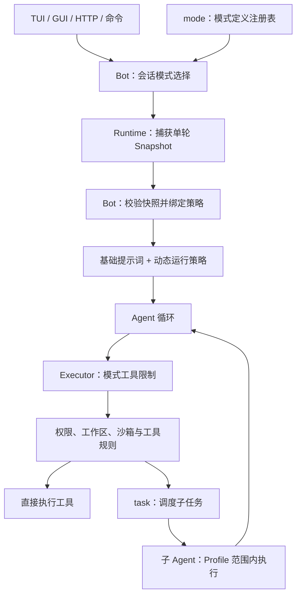
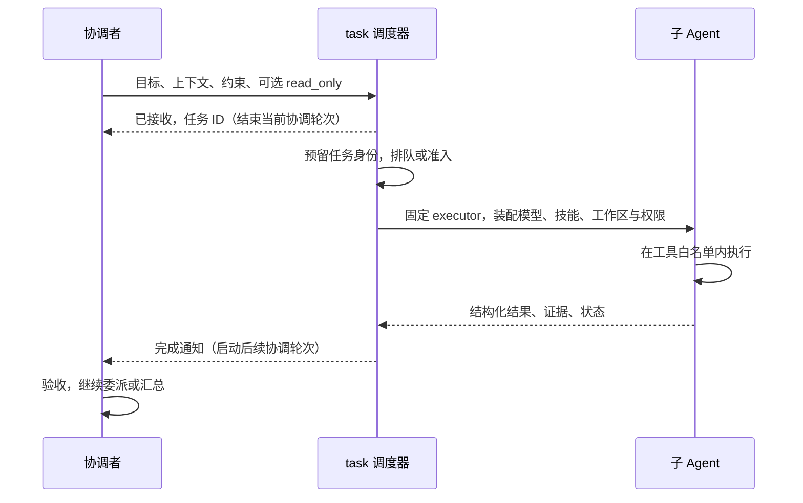

# 工作模式框架原理

**主要读者：** 修改 NekoCode 模式框架、接入运行宿主或审查权限边界的开发者。本文描述当前实现。操作方法见第一部分：[工作模式教学](../users/INTERACTION_MODES.md)。

## 1. 框架负责什么

工作模式描述任务的组织方式。框架把模式定义、会话选择、单轮运行、工具限制和子任务调度分开维护。



| 部分 | 职责 | 主要代码 |
| --- | --- | --- |
| 模式定义 | ID、版本、角色、策略、工具范围和提示词 | [mode.go](../../mode/mode.go) |
| 会话选择 | 读取、切换、保存模式，拒绝并发切换 | [bot_mode.go](../../bot/core/bot_mode.go) |
| Runtime 接入 | 对外模式服务、运行边界、变更事件 | [interaction_mode.go](../../runtime/interaction_mode.go) |
| 执行宿主 | 安装单轮策略、运行与清理 | [bot_run.go](../../bot/core/bot_run.go)、[bot_strategy.go](../../bot/core/bot_strategy.go) |
| 上下文 | 将模式提示词投影到动态运行状态 | [contextmgr_context.go](../../bot/contextmgr/contextmgr_context.go) |
| 工具策略 | 模型可见性和调用硬限制 | [tool_policy.go](../../bot/extension/tool/runtime/runner/tool_policy.go) |
| 子任务 | Profile、模型、权限继承和任务记录 | [bot_subagent.go](../../bot/core/bot_subagent.go) |

当前没有独立的 Super Agent 调度引擎。两种执行策略共用 Agent 循环，Super Agent 通过协调者工具范围，把实际工作导向 Runtime 后台任务服务和已有 subagent 引擎。

## 2. 模式由哪些字段组成

`mode.Definition` 包含 `Snapshot`，再加显示名称、描述和提示词。`Snapshot` 是每轮捕获的值：

```go
type Snapshot struct {
    ID         ID
    Version    int
    Role       Role
    Strategy   Strategy
    ToolPolicy ToolPolicy
}
```

| 字段 | 含义 | 当前例子 |
| --- | --- | --- |
| `ID` | 稳定的模式标识，用于选择和保存 | `standard`、`plan`、`super-agent` |
| `Version` | 完整策略定义的版本 | 当前均为 `1` |
| `Role` | 当前参与者的职责描述 | `general`、`planner`、`coordinator` |
| `Strategy` | 由执行宿主绑定的运行入口 | `direct`、`delegated` |
| `ToolPolicy` | executor 实际执行的工具范围限制 | `all`、`read_only`、`coordination` |

`Role` 表达参与者职责，可用于 Profile 的来源校验，但不会自动授予工具；主对话的工具硬限制由 `ToolPolicy` 实现。`Strategy` 也不表示模型：主模型和子任务模型分别由现有配置与 Profile 解析。

注册表返回定义副本，运行上下文保存快照值。`Validate` 会把完整快照与当前内置定义比较；未知 ID、未知版本或被改写的工具策略都会被拒绝，不能自动降级成 Standard。

`NewRegistry` 可构造定义集合，但当前应用使用代码中的内置注册表，没有让插件或配置文件动态注册工作模式的入口。新增一个 Profile 不会自动新增一种模式。

## 3. 三种模式的执行方式

| 模式 | Role | Strategy | ToolPolicy | 模式提示词 |
| --- | --- | --- | --- | --- |
| Standard | `general` | `direct` | `all` | 无额外模式提示词 |
| Plan | `planner` | `direct` | `read_only` | [plan.md](../../mode/plan.md) |
| Super Agent | `coordinator` | `delegated` | `coordination` | [super_agent.md](../../mode/super_agent.md) |

### Standard

主 Agent 通过现有循环推理、选择工具、接收结果并继续。`all` 允许通用工具，但仍排除注册为协调者专用的工具；后面的权限、工作区、沙箱、写前读和工具自身校验仍然有效。

Standard 可以使用 `task`，因此委派不是 Super Agent 独有的能力。

### Plan

主 Agent 沿用同一循环，但只能调用白名单工具。内置工具注册处通过 `PlanAllowed` 声明只读能力；兼容接口 `SetPlanTools` 可显式覆盖该白名单。

当前白名单包含读取、搜索、网页工具、上下文引用、已有任务列表，以及获准的 diff、索引和部分 LSP 查询。shell、写入、编辑和 `task` 不在允许范围内。判断依据是注册元数据，不是模型声称“这条命令只读”。

Plan 提示词要求先调查、给出实施步骤、风险和验收方法。它还要求实施前得到用户同意；持久 Plan 下，自然语言同意不会自动切换执行模式。

### Super Agent

主 Agent 是协调者，只能使用以下工具：

| 工具 | 用途 |
| --- | --- |
| `agent_profiles` | 查看执行者、工具范围、模型覆盖和加载错误 |
| `task_result` | 分页读取所属子任务完整结果并固定执行轮次与内容版本 |
| `task_submit` | 异步创建或继续子任务，立即返回接收凭据 |
| `task_cancel` | 按任务 ID 请求取消 |
| `task_list` | 查询当前父会话的任务记录 |
| `question` | 向用户收集决策或缺失信息 |
| `todo_write` | 维护编排进度 |

允许范围由可信注册处的 `CoordinatorAllowed` 声明。文件、网页、shell、修改和通用 MCP 执行代理默认都不能进入这个集合。

`CoordinatorOnly` 是独立的模式限制，当前用于 `task_submit` 和 `task_cancel`。它们在 Standard/Plan 的工具描述中隐藏，直接调用也会被执行边界阻断；FULL 权限或 Plan 白名单不能放宽该限制。`task_result` 不受这一专用限制。

`delegated` 当前也绑定 `Agent.RunContext`，但主 Agent 只能通过 `task_submit` 发起执行。它不会因为策略名称不同而拥有一套新的对话循环或调度数据库。

## 4. 一轮请求怎样运行

1. UI、命令或 API 修改会话选择。Bot 保存模式；保存失败时恢复原选择。新会话默认 Standard，分叉继承来源选择，恢复时读取已保存模式。
2. Runtime 先处理控制命令；只有输入确实需要进入 Agent 时，才解析有效模式。`/plan <任务>` 为该轮选择 Plan，不修改会话偏好。
3. 接收运行时捕获 `Snapshot`，通过 context、接受输入事件和运行记录传递。追加指示沿用这份快照；执行中或等待人工交互时拒绝切换模式。
4. Bot 校验完整快照，通过 `interactionStrategy` 取得执行入口，把快照安装到 executor，并调用 `SetRuntimePolicy` 安装该模式提示词。
5. Agent 组装模型请求，执行工具并反馈结果。调用必须通过模式和后续授权校验。
6. 正常结束、取消或出错时，清理单轮工具策略和运行时提示词；会话选择继续保留。下一轮会重新安装当轮策略。

空白草稿有独立处理：保存模式不应丢弃当前草稿身份，也不应让空会话进入已保存列表。恢复到未知模式时仍保留其 ID，允许查看历史，但执行前必须显式选回受支持的模式。

### 提示词放在哪里

Plan 和 Super Agent 的文本分别维护在独立 Markdown 文件中，通过 `go:embed` 加载。运行时调用 `SetRuntimePolicy(definition.Prompt)`，上下文管理器把它放入动态状态：

```xml
<runtime_context mode="replace">
  <!-- 此处省略 environment_state 和 todo_state -->
  <runtime_policy_state>
    当前模式提示词
  </runtime_policy_state>
</runtime_context>
```

这段状态以带来源标记的 `user` 消息投影到模型上下文，基础 system prompt 保持不变。新的完整运行状态会声明替换旧状态；清理时策略变为 inactive，不需要删除所有历史消息。

因此可以说“基于基础提示词补充模式要求”，但实现上不是把文本直接拼到 system prompt 中。提示词用于引导推理，不能代替工具硬限制。

## 5. 硬限制如何覆盖执行前后

模式检查覆盖多个入口，避免只拦最后一步却提前产生效果：

```text
模型返回工具调用
    ↓
CheckToolPolicy：模式允许吗？
    ├─ 否：记录 mode 阶段的 blocked 结果，不触发该调用的前后工具 hook
    └─ 是：进入工具治理 hook、子任务准入等后续流程
                ↓
          预览入口再次检查模式
                ↓
          executor 分发时再次检查模式
                ↓
          权限、工作区、沙箱和具体工具校验
```

预览可能读取文件生成 diff，因此 [executor_preview.go](../../bot/extension/tool/runtime/runner/executor_preview.go) 也必须先检查模式。直接调用 executor 的宿主同样受分发边界保护。全局生命周期或批次 hook 仍有自己的触发契约，模式拦截针对被禁止的具体工具调用。

Super Agent 的模型请求还会过滤工具描述，使协调者只看到编排工具。Standard 和 Plan 保留原有描述集合；Plan 即使看到未获准工具，调用也会被拒绝。工具描述是否可见，不是最终授权依据。

注册表在一个原子 `Entry` 中保存工具及其元数据。替换工具会整体替换 Entry，移除工具会同时移除元数据；模型描述过滤也从同一 Entry 读取，避免旧 schema 与新权限标记混用。

这里有三种不同限制：

| 限制 | 决定什么 | 是否受 FULL 解除 |
| --- | --- | --- |
| 模式工具策略 | 当前参与者可以调用哪类工具 | 否 |
| 子任务 Profile | 执行者可以使用哪些工具 | 否 |
| 权限与沙箱 | 某次操作是否获准、可访问哪些资源 | 按现有规则处理；FULL 不等于移除全部边界 |

## 6. 子任务如何执行和返回

Super Agent 调用 `task_submit` 后，由 Runtime 的后台服务接管独立执行。跨轮次共用 8 个执行槽位和有界队列，任务组轮转；共享工作区写任务串行，隔离 worktree 可独立调度。Standard 的 `task` 仍同步等待结果。任务 ID 标识可继续的子会话，attempt ID 标识其中一次执行，两者不可互换。历史容量检查仅针对新增任务 ID；恢复已有 ID 不增加条目。需要新增空间时清理足量已消费且无未读追加的终态记录，不能淘汰未处理结果。后台最终状态在队列锁内判定，取消优先于部分完成结果。



子 Agent 的运行上下文使用 Standard 执行策略，避免继承协调者的“只能委派”限制。这不会让执行者拥有全部能力：子 Agent 引擎继续按 Profile 的精确工具白名单约束调用，且不允许递归委派。

权限继承独立处理。父执行器通过 `ConfigureChildPermissions` 提供规则、项目授权存储和实时权限状态；子执行器仍有自己的工作区与沙箱配置。模型来自 Profile 可选覆盖，否则跟随主模型，技能仅提供工作流。

任务以 completed、partial 或 failed 等结果返回；取消和具体尝试状态另有记录。协调者应依据结构化结果和证据验收，不能把一次工具成功或部分结果当成整个需求完成。

受理快照在 BackgroundWork/BackgroundTask 中保存本次 Prompt，排队事件与列表仅携带有界摘要。TUI 在子会话尚不存在时通过 BackgroundTaskPrompt 按父会话和任务 ID 获取全文；异步回复校验页面 generation、请求号及任务 ID。排队恢复任务用尚未创建 attempt 的视图展示新指示，实际开始时再切入新 attempt，旧的提示词读取回复不会覆盖执行中的详情。正式执行记录和旧轮次继续从子会话历史读取。

TUI 子任务浮层使用独立、按浮层 generation 隔离的 100 ms 动画时钟，不依赖主对话继续处理；主对话时钟运行时避免重复推进帧，关闭或旧浮层的 tick 不续订。进入详情、返回列表等更换 generation 的路径同步重启轮询和动画时钟。动画只使状态卡片缓存失效，不移动阅读位置。Runtime 从任务事件捕获 attempt ID/seq，在取消、错误和兜底结束事件中保留身份；详情页只更新匹配尝试的状态，旧的无身份终态事件触发规范记录重读，不直接覆盖当前尝试。

后台任务拥有独立 context、工具箱、输出与审批路由。前台回复结束或取消不会取消已经受理的后台任务。`task_cancel` 和 Runtime `CancelBackgroundTask` 取消指定任务；程序关闭会取消全部后台执行并等待收尾。每次后台执行拥有独立的私有交互作用域；审批、提问和取消回调按该作用域清理，避免旧执行收尾拒绝同一任务新轮次的请求。对外事件仍使用 `task_<id>` 作为 RunID，保留现有订阅和归档兼容性。前台请求的作用域仍等于其 RunID。旧宿主回调还会检查当前条目归属，不能改写新执行的状态或追加队列。

`runtime/background.go` 管理受理、调度和状态，`background_coordinator.go` 管理输入队列、完成通知和自动协调轮次。后台完成先保存结果，再发通知；同组就绪通知最多 16 条合并处理。通知以 runtime event 进入 Agent 历史，不伪造旧工具返回。主对话始终只有一个历史写入者。

每个会话的 `background.json` 保存版本化接收记录与通知投递状态。领取通知后先持久化 claimed，再启动协调轮次；成功标记 delivered，中断或崩溃后标记 failed，不自动重放可能产生副作用的验收。未开始处理的完成通知可以在恢复该会话并进入 Super Agent 运行后处理。未结束执行标记 interrupted，不恢复可执行闭包。排队需求保存在同一 sidecar 的 v2 `demands` 字段；读取兼容 v1。受理前保存 queued，启动前保存 claimed，协调轮次结束后保存 done 或 interrupted。重启时 queued 转为 pending，claimed 转为 interrupted，均不自动执行；只有 pending 可通过显式恢复重新入队。继续操作在 mutation 锁内校验会话与 Super Agent 模式，所有存储失败均返回错误或保留诊断。

`BackgroundTasks` 查询不唤醒调度或发起模型轮次；任务受理、执行结束及前台轮次结束负责唤醒。协调轮次因 Busy 未能启动时归还待处理项，并在释放协调占位后重新唤醒，避免前台结束通知提前消费导致停滞。其他启动失败保留结果并标记投递 failed，发布诊断，不自动反复重试。

指定任务追加通过 `Runtime.AppendBackgroundTask` 进入对应任务的 `PendingUpdates`，校验会话归属、活动状态和队列上限（16 条，每条最多 8192 字节）。子任务宿主可选实现 `protocol.BackgroundInputSource`；执行器通过 `RunConfig.PendingUpdates` 在模型轮次边界读取带序号的 BackgroundUpdate，在子任务上下文 checkpoint 成功后才确认移除已读前缀，并发到达的后缀保留。任何存储失败都会停止本次交付并保留队列，不静默吞掉追加。

`Runtime.StopBackgroundTasks` 在同一 mutation 锁下取消当前 Super Agent 轮次、已预留的协调轮次、当前会话排队需求与后台执行，并将该批通知标记 stopped。提交在队列锁内重查取消，`StartRun` 获得 mutation 锁后也重查取消，防止停止后迟到的提交或通知重启任务。新需求可重新开始；普通 `CancelRun` 仍只取消当前轮次。

GUI 后台面板通过 Wails 绑定调用同一组 Runtime 接口，按会话 ID 过滤状态，追加和取消携带明确的任务与会话身份；新需求通过 `SubmitBackgroundDemand` 在 admission 锁内验证提交时的会话和 Super Agent 模式。前端只在收到 `gui_queue` 受理事件时创建对应对话轮次，不提前更换当前回复的缓冲区。面板监听 `background:changed`（150ms 合并刷新），每 5 秒完整重同步，即使主对话空闲也持续更新。审批和提问共用 FIFO，按请求 ID 消费并显示 SubAgentID。

两个文件之间不使用事务，而通过递增序号保证追加文本去重：Runtime 为任务维护 UpdateSequence，子任务通过 AddTaskUpdate 将文本与接收序号一起加入上下文，ManagerSnapshot 和 session.json 保存 TaskUpdateSequence，消息本身也保存该序号。恢复时同时扫描有效用户消息，因此 transcript 已追加、manifest 尚未提交的尾部也能恢复接收标记。压缩不会重置标记。Runtime 历史已清理时，从子会话的规范元数据恢复序号起点；不会从观察缓存推断接收状态。旧版本没有序号的历史不能追溯证明过去是否重复投递。任务最后一轮期间到达的追加保留为未读，恢复同一任务时继承；历史清理不会淘汰有未读追加的条目。GUI 后端与 TUI 命令共用上述 Runtime 接口，界面不直接改队列。状态文件保存和读取均受 32 MiB 上限限制。

需求收件箱每会话最多保留 256 条，正文最多 64 KiB，活动队列最多 128 条。容量不足时只淘汰 done/cancelled 回执，不丢弃尚未处理或中断的需求。序列化后仍受统一 32 MiB 上限约束，避免转义膨胀后写出无法读取的状态。停止全部同步标记排队、已认领及恢复待处理需求为 cancelled。GUI 的 queued 受理标识按 RunID 投影，不依赖最初来自哪个客户端，保留原 Source 和 Sender。

前台空闲时可切换会话、模式、模型和推理深度。资源快照变更不替换旧 worker 的捕获值，破坏性扩展/MCP/config/session 删除仍由后台资源屏障阻止。协调者启动 context 绑定父会话，在 admission 前若会话或模式变化，则保留未启动回执，切回后处理。审批 authority 按父会话 ID 保存，生命周期不随 Agent 重建而变化；同一会话内的手动/AUTO/FULL 调整实时传给已派发 worker，epoch 只用于使旧审批快照失效，不冻结审批模式。会话切换选择各自的 authority，其他会话的权限变化不会提升或收紧原任务的模式。后台 Profile 只绑定可信的独立工具能力，不复用可能捕获父状态的扩展闭包。

todo 是 Standard、Plan、Super 共用的轻量交付清单，执行不要求关联工具或 subagent。计划按需求 ID 隔离并随会话快照保存；新需求不自动继续旧计划。todo_write 返回稳定的 plan_id 和步骤 ID，旧的 content/status 调用仍可匹配同名步骤；更名应携带 ID。提供 plan_id 且不提供 todos 会显式激活已有计划并返回完整清单，旧无 ID 项在激活时保存稳定 ID；只能选择本会话的计划，后台验收不能切换到其他需求。

todo_write 更新按单写者流程校验、保存，再发布 UI 事件；保存失败只回滚计划并返回错误。未完成项不能静默省略，completed 需简短 result，blocked/cancelled 需 reason，始终至多一项 in_progress。所有模式共用结束检查：仍有可推进项时要求继续执行、分析或验证；已有同组后台任务时允许让出轮次；受阻/取消项保留并在收尾明确列出。连续三次纠正仍无完成进展时报告剩余项，用户中断不会触发自动重做。

后台任务持有服务租约时，项目重载记录为待处理；最后一个租约释放后，在与前台执行互斥的安全边界自动补做。关闭 Bot 后不再补做重载。

后台调度与通知由 Runtime 托管，会话记录和 worktree 隔离复用原有子任务系统。模式注册表不负责并发队列、任务结果或恢复状态。

创建独立副本时，普通失败会清理本次尚未执行的副本和快照引用，允许同 ID 重试。进程崩溃或清理失败仍保留恢复记录；清理错误给出显式删除命令。已有副本及其成果不进入创建失败回滚。

### 完整结果与显式交接

`task_result` 使用 taskbridge 的 ResultQuery/ResultPage 契约。ResultPage.isolation 标识报告来源使用 shared 还是独立 worktree；workspace_kind 单独标识 shared、head 或 snapshot，随规范子任务元数据、任务列表和结果页持久保留，旧记录缺失时不推断成 HEAD；引用只分享报告，不分享文件和补丁，不能在未修改的 HEAD 上验证其他副本中的改动。父工具由 Bot 绑定当前父会话，session.ReadSubagentResult 只读取规范 session.json 中明确终态的 SubagentAttempt.Result，不使用截断的 observation.json。首次可选 attempt_id，默认当前已保存轮次；分页引用包含父会话、任务、轮次、状态及正文 SHA-256。后续页校验绑定和摘要，不能混读恢复后的新结果；引用是证据标识，不是权限凭证。

偏移和长度按 Unicode 码点计数，每页默认 1000、最多 2000，工具再校验 JSON 序列化字节不超过 16 KiB 的统一输出预算。非零偏移必须带 result_ref，超范围、引用不匹配、正文变更、非终态及缺失结果均明确报错，不静默转向摘要或最新轮次。

主工具注册 CoordinatorAllowed/PlanAllowed，不设置全局 DelegationAllowed。新任务使用 inputs 或 after 时必须显式指定 isolation，否则在受理前报错；验收上游实际代码应 resume_id 原任务以沿用其工作区。task_submit 的 inputs 接受最多 8 个结果引用；装配层在受理前验证父会话、版本与状态，捕获精确白名单，注入有界预览，只为该执行者装配受限 task_result。子工具拒绝没有被分享的引用和按任意任务 ID 查询。这个绑定独立于父 Agent 对象，read_only 任务也能读取显式证据。

SubagentMetadata.result_inputs 保存引用范围，快照克隆会复制切片，恢复从规范元数据读取。恢复时省略 inputs 表示继承，显式列表仅可收窄；工具范围仍受原 tool_ceiling 限制。inputs 不建立运行中的依赖队列，也不授权重放上游工具。Runtime 完成通知保留 attempt_id/attempt_seq，便于协调者选择准确的结果版本。

### 通用执行者 executor

`explore`、`coder` 及自定义 Profile 仅供 Standard 的同步 task 使用。Super Agent 的 task_submit 不暴露 profile 参数，显式传入该参数会报错；装配层还会拒绝非 executor 和旧 Profile 恢复，不能通过直接构造 TaskSpec 绕过。agent_profiles 在 Super Agent 中只展示 executor。`executor` 由宿主动态解析，声明 `RequiredRole: coordinator`，在当前模式中仅 Super Agent 可委派；它不是插件 frontmatter 可继承的 `base`。

`agent_profiles` 根据可信运行快照过滤受限 Profile。创建及恢复入口还会调用 `Profile.CheckSource` 校验完整快照，不能通过手写 Profile 名称、恢复 ID 或改写工具策略绕过。源角色被纳入 Profile 配置哈希。

可信注册处以 `DelegationAllowed` 明确标记可交给执行者的工具。动态能力不是“所有已注册工具”：派发时取父注册表声明和独立工具箱支持范围的交集，加入捕获的具体 MCP 目标，排除委派、模式/会话管理等控制能力。配置媒体模型后，相应工具才进入范围；原有 permission planner、预览和沙箱仍有效。

`read_only=true` 是同一 executor 的任务级能力约束，不是另一种 Profile。SubmitTool 严格校验布尔值，装配层将工具白名单与可信注册项的 PlanAllowed 标记取交集，因此 shell、写入和 MCP 不进入只读执行者。默认能力仍支持命令。恢复始终与保存的 tool_ceiling 取交集；后续省略 read_only 也不能放大已经收窄的任务。只读任务以 ReadOnly 身份参与 Runtime 调度，共享工作区写任务仍串行。

MCP 的 `ToolSnapshot` 捕获就绪工具的 schema、具体 server/tool 身份和原连接。后台的 `capability` 使用该受限快照，list、inspect、call 均不能扩展范围。真正的调用仍以转义后的 `mcp__server__tool` 身份参与权限校验；FULL 不绕过 deny。服务关闭或同名替换后，旧绑定拒绝执行，不重定向至新连接。连接生命周期由现有 MCP Manager 管理，Runtime 的后台资源变更屏障负责保持资源有效。

worktree 的 `executor` 排除 MCP。宿主不能保证原服务随 worktree 改变工作目录，因而不会静默复用该连接。

`SubagentMetadata.tool_ceiling` 保存实际能力范围。恢复时取当前可用范围与已保存上限的交集；存储层也拒绝扩大范围。`null` 表示旧记录未捕获，`[]` 表示捕获了空集合，两者不能混淆。用于恢复的 `ReadSubagentMetadata` 直接读会话主记录，不使用省略权限字段的 `observation.json` 展示缓存。

## 7. 如何扩展模式

新增内置模式的接入步骤：

1. 在 `mode` 注册表增加稳定 ID、版本和定义；需要额外指令时增加提示词文件。
2. 优先复用已有 `Strategy` 和 `ToolPolicy`。只有运行流程确实不同时，才在 `bot/core.interactionStrategy` 绑定新的执行实现；不能只增加一个策略名称。
3. 需要新工具范围时，在 executor 实现统一策略，并检查描述过滤、hook 前置检查、预览和分发是否一致。新增工具默认不继承旧工具的特殊允许标记。
4. 若会创建子任务，分别定义协调者与执行者的职责，保留 Profile 和权限边界，不能照搬协调者限制，也不能默认放开执行者。
5. 验证会话保存与恢复、未知版本拒绝、FULL 下的模式限制、伪造调用、取消与清理，以及现有模式兼容性。

TUI、GUI 和命令菜单从同一注册表获取选项，不需要为新模式各写一套枚举。角色、模型配置、技能和任务调度也不需要为了新增模式复制一份。

对外接入沿用 [Runtime HTTP API](RUNTIME_HTTP_API.md)：`GET /mode` 返回 `{selected, options}`，`POST /mode` 接受 `{"mode":"plan"}` 等请求，运行中修改返回冲突。模式变化通过 `interaction_mode_changed` 事件通知；它与既有 permission Mode 字段分开。`AccessObservation.PlanMode` 是兼容观察字段，并非第二份模式状态。

## 8. 关键回归入口

| 检查目标 | 测试文件 |
| --- | --- |
| 注册表副本、快照版本和完整性 | [mode_test.go](../../mode/mode_test.go) |
| 会话保存、草稿、切换失败回滚和未知策略 | [bot_mode_test.go](../../bot/core/bot_mode_test.go) |
| 协调者拒绝先于工具 hook 和预览 | [tools_test.go](../../bot/agent/tools_test.go) |
| FULL 不能越界、子任务权限、预览入口 | [interaction_mode_test.go](../../bot/extension/tool/runtime/runner/interaction_mode_test.go) |
| Standard 同步委派、只读执行和子任务恢复 | [subagent_demo_test.go](../../bot/core/subagent_demo_test.go) |
| executor 的 MCP、媒体、审批和原任务恢复 | [executor_test.go](../../runtime/standard/executor_test.go) |
| MCP 固定连接、目标范围与撤销 | [snapshot_test.go](../../bot/extension/mcp/snapshot_test.go) |
| 异步委派、真实读取与自动验收 | [background_test.go](../../runtime/standard/background_test.go) |
| 排队、取消、审批隔离和重启恢复 | [Runtime 后台测试](../../runtime/background_test.go) |
| HTTP 参数验证和运行边界 | [HTTP 测试](../../runtime/httpapi/interaction_mode_test.go) |

涉及模式变更时，除测试模式选择外，还应覆盖真正执行工具的链路，尤其是错误、取消和清理路径。

## 后台依赖、管理与归档

`task_submit.after` 和 `BackgroundWork.After` 声明最多 8 个已受理上游任务 ID。新任务只能引用当前会话已有任务，不接受自己、重复项和前向引用；`resume_id` 不能附加 after。等待状态 `waiting_dependencies` 计入有界队列，不占 8 个执行槽位。上游 completed 且释放执行槽后，下游变为 queued；partial/failed/interrupted/blocked 向下游传播 blocked。执行前通过规范结果读取取得 result_ref，按 inputs 的同一结果能力白名单装配，不授予旁系任务访问权。存在等待/活动下游时，上游不能被恢复或淘汰，避免引用变成新尝试。

`RetryBackgroundNotification` 只接受 Delivery=failed 的终态任务，原子保存后重新唤醒验收，不恢复执行闭包。DeliveryAttempts 与 DeliveryError 保留诊断；新的会话/模式冲突视为未启动，回到待消费队列，不消耗原需求。

`BackgroundUsageSink` 在规范子任务 checkpoint 后保存累计样本，Runtime 以同 attempt 的差值更新总量。恢复时由 Sessions.SubagentUsage 对账；retired_usage 保留删除/淘汰任务的消耗。统计在同一任务锁内读取，避免与退休迁移重复计算。原始主会话轮次指标不混入 worker 事件。

后台公共事件仍使用 task_<id>，录制 sink 将实际执行映射到 task_scope_<uuid>，并固定原父会话。仅受理未执行的任务不创建执行归档；执行结束关闭文件与归档租约。TUI/GUI 将后台事件与主回复投影分开，审批/问题仍由全局请求 FIFO 路由。

`Subagents(AllSessions:true)` 跨父会话分页并标记归属，详情读取始终携带父会话 ID。`DeleteSubagent` 使用 Runtime admission 门及父目录管理锁→任务活动 OS 锁的顺序，先验证活动/依赖状态，再删除任务和输出 namespace。存储通过 os.Root 限定父会话路径，拒绝中间符号链接；删除标记阻止旧事件与同 ID 续跑复活。

`SearchSubagentOutputs` 按提交水位流式扫描工具输出，以 message sequence 翻页，保留跨 64 KiB 输出页的匹配边界。`ExportSubagentOutputs` 面向 io.Writer 流式写出各轮工具输出；缺失或未保存完整的工件明确报告，不返回空成功。对应 HTTP 与 Wails 入口见 Runtime HTTP API。

执行闭包还持有 Bot 的后台资源计数租约。受理失败由提交方归还；正常执行、排队取消、停止全部、依赖阻断与关闭均由 Runtime 在任务锁内恰好归还一次。存在租约时，会话切换只恢复稳定指令，不隐式刷新项目扩展或 MCP；最后一个使用者结束后，显式项目刷新可应用新的定义。

### 跨轮恢复与收尾契约

后台任务的 `group_id` 标识所属需求，而不是本次执行 run。恢复已有任务沿用原归属；Runtime 从已保存的后台状态恢复归属，执行者在首次模型请求前将其写入规范子会话。即使后台历史已清理，后续恢复也从规范元数据获取归属。旧记录无该字段时优先沿用保留的后台状态；两者均缺失时按当前明确选择的计划建立归属，不猜测历史关系。完成通知不能恢复另一需求的任务。受理回执包含 `plan_id`；需要为原需求追加新任务时，先通过 `todo_write(plan_id=...)` 显式选择已有清单，新的用户需求不会自动承接旧计划。

`task_result.next_call` 携带完整的 `result_ref`、task/attempt 身份及分页参数，跨轮次和缓存重置后仍可直接调用。引用只标识固定结果，父会话权限和内容摘要校验继续生效；结果已删除或变化时明确报错。

所有模式的 `todo_write` 失败都会记录本轮未同步状态，包括尚未成功创建清单的情况。收尾前最多要求两次纠正；成功更新后清除失败状态，持续失败则保留报告并追加清单同步失败说明。不会因此自动跨计划修改、无限重试或宣称清单已全部完成。

### 审查证据与增量基线

子 Agent 的交接可附 `verification_checks`（最多 32 项）：每项记录 `name`、`status`（passed/failed/blocked/not_run）、`evidence`、`entrypoint`、`scope`、`limitations`。旧调用保留兼容；省略或空数组被明确呈现为“验证覆盖未报告”，不能解释为验证通过。宿主校验结构并固定输出状态计数、入口、适用范围和限制，不推断结论真假，也不因环境阻塞把成功交接改成执行失败。主 Agent 必须保留失败、阻塞和未执行项目；人工复用对象的 helper 探针不等于生产链路可达性证据。

隔离工作区的 Git 内容基线在模型执行前由宿主保存为 `workspace_base`，snapshot 同时记录 `source_head`。`task_result` 每页都返回这两个可选字段；前者包含快照收录的脏工作区内容，后者只是源 HEAD。基线一经记录不能随任务恢复改变，旧任务缺失时保持未知。增量审查在确认属于同一仓库后比较两次 `workspace_base`，不按快照 mtime、文件数量或 HEAD 猜测增量。提交 ID 只供观察，不扩大读取权限或授权 worktree apply。

批量验证先确认实际执行环境的缓存/临时空间、本地回环和依赖；沿用适用的已有诊断，环境或证据变化时才重检。环境阻塞属于覆盖缺口，不能概括为“没有回归”；不得为获取绿色测试自动放宽权限。

复核冲突结论必须保留原始事件时序和代码版本。简化时序下通过的测试不能反驳更复杂时序中的失败；断言应检查实际可见状态，并排除其他守卫造成的同样现象。验证修复优先提供修前失败、修后通过的对照；无法做到时明确限制，日志和恒真断言只算观察。相同环境阻塞最多进行两次有证据支持的修复尝试，仍失败则交接 blocked 与原因，由主 Agent 选择改变条件、缩小验证范围或报告缺口；该规则是委托流程约束，不靠解析 shell 命令强行拦截安装。

GUI 将尚未受理的本地输入与当前回复分开记录：旧轮次的 Done 不清除其归属，旧回复结算后也不能被后续受理或迟到的 RPC 失败删除。普通 GUI 输入以 InputAccepted 确认受理，控制命令允许直接结束；其他客户端的排队输入不会消耗本地请求的占位。Runtime 排队 demand 的 ID 在受理执行时可以直接成为 currentRun；生命周期和停止清理应通过真实入口测试，不能仅凭 run_/queued_ 前缀推断。
