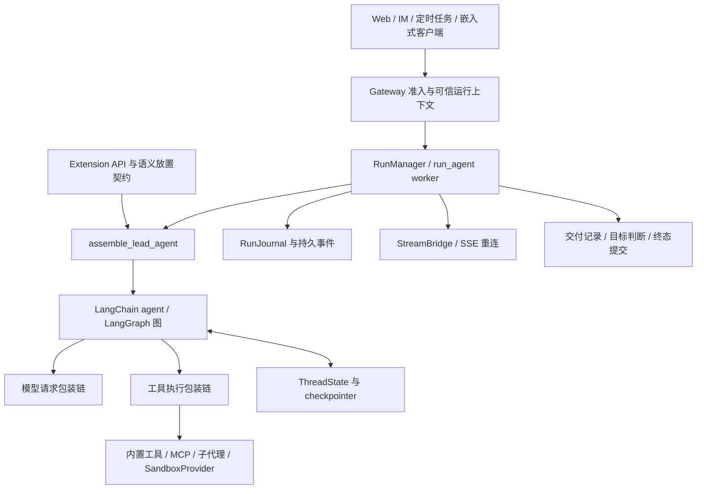

# DeerFlow harness 架构调研与 NekoCode 对照

本文保留源码调研与候选设计依据，按仓库文档约定归入规划目录，不作为未完成任务清单。已落实的 harness 契约见[架构边界](../maintainers/ARCHITECTURE_BOUNDARIES.md)；预算与子任务后续范围分别以各自实施计划为准。

调研日期：2026-11-01。DeerFlow 本地版本：`35656d6`；NekoCode 本地版本：`b40909b`。

本文以两个本地 checkout 的实现为依据，交叉阅读入口、状态、工具执行、持久化及相关测试。它不是 DeerFlow 所有版本的通用描述，也没有做模型效果、吞吐量或安全攻防实验。文中的“缺口”指本次检查到的实现差异；建议部分是架构判断，不代表已复现生产故障。未访问线上资料，也未修改业务代码。

## 1. 结论与适用边界

NekoCode 已经有自己的 harness：多端 runtime、主/子 agent loop、工具 executor、确定性 policy、上下文预算与压缩、会话和事件记录、权限 broker、原生沙箱、worktree 隔离以及插件系统。将它描述成“只有一个模型循环”会误导改造方向。

DeerFlow 最值得参考的，是将运行过程拆成有明确来源、所有权、生命周期和恢复语义的契约：

1. **模型上下文是状态的投影。** 摘要、目标、委派、技能引用、产物等分别保存，再按信任级别和预算投影给模型。
2. **一次回答、一次工具成功、一次任务验收是不同事实。** 工具 receipt、子代理引用检查、run delivery 和 goal evaluation 分层表达。
3. **运行可靠性覆盖整个生命周期。** 准入、checkpoint 写入、事件流、取消、终态持久化和资源释放之间有顺序与所有权约束。
4. **装配结果本身可观察。** 不只记录调用了哪个模型，还能识别实际 prompt、工具、middleware、skill 和 policy 的版本组合。

对 NekoCode，建议先做上下文权威边界、结构化连续性、版本化写前读和运行指纹；随后做统一执行证据。远程 sandbox、持久批处理、分布式租约和自动记忆应由明确产品需求驱动。

不要照搬 Python/LangGraph 栈，也不必把 NekoCode 改成几十个 middleware。值得迁移的是契约及其不变量。

## 2. DeerFlow 的核心架构

### 2.1 应用层、运行层、agent 层与执行环境

这张图是概念层次图，不表示所有入口都必须经过 HTTP。嵌入式 `DeerFlowClient` 可以直接装配图、共享 middleware 和 checkpointer；Gateway 另承担完整的 run 准入与服务生命周期。

服务端实际运行链是 Gateway 内嵌 runtime，不应按早期“独立 LangGraph 服务”的印象理解当前 checkout。关键入口：

- [lead_agent/agent.py](/home/lznauy/precode/opensource/deer-flow/backend/packages/harness/deerflow/agents/lead_agent/agent.py)：`assemble_lead_agent` 返回 graph、descriptor、effective model；公开兼容入口 `make_lead_agent` 返回裸 graph。
- [runtime/runs/manager.py](/home/lznauy/precode/opensource/deer-flow/backend/packages/harness/deerflow/runtime/runs/manager.py)：run 登记、准入、状态持久化、终态确认和并发控制。
- [runtime/runs/worker.py](/home/lznauy/precode/opensource/deer-flow/backend/packages/harness/deerflow/runtime/runs/worker.py)：装配、图执行、流转发、目标续跑及最终清理。
- [client.py](/home/lznauy/precode/opensource/deer-flow/backend/packages/harness/deerflow/client.py)：嵌入式路径。

NekoCode 的对应分层已经存在：`runtime → runtime/standard → bot/core → bot/agent → runner/provider`。可以沿现有边界补契约，无需另建一套“harness 框架”。

### 2.2 Agent 装配不是简单拼 prompt

DeerFlow 装配时确定实际模型、推理/视觉能力、可见且获授权的工具、skill 范围、memory 策略、subagent 配额、middleware 顺序和扩展贡献。descriptor 取材于同一次真实装配，避免观察系统重新猜测配置。

模型链和工具链是两条不同轴。输入清理、动态上下文、durable context、压缩、工具过滤、循环检测、token 限额和响应兼容处理影响模型请求；输出预算、结果清理、授权、read-before-write、receipt 和异常包装影响工具执行与结果。

包装链的列表顺序不等于所有 hook 的统一执行顺序，因此扩展 API 声明语义位置：

| 位置 | 保证 |
| --- | --- |
| `MODEL_LOGICAL` | 位于重试之外，一次逻辑决策观察一次 |
| `MODEL_PHYSICAL` | 位于请求变换之后，每次实际 provider 调用都经过 |
| `TOOL_RAW` | 靠近真实工具调用，看到原始结果 |
| `TOOL_VISIBLE` | 位于截断、清理、错误包装之外，看到模型最终可见结果 |

这比允许插件填写任意 middleware 数字下标更稳定。NekoCode 的 policy hook、executor 回调和 calllog 也跨越这些位置，但目前未形成同样统一的语义轴。应先为现有 hook 标注语义，而非开放插件任意改写所有请求。

来源：[placement.py](/home/lznauy/precode/opensource/deer-flow/backend/packages/extension-api/deerflow_extension_api/placement.py)、[共享 runtime middleware 装配](/home/lznauy/precode/opensource/deer-flow/backend/packages/harness/deerflow/agents/middlewares/tool_error_handling_middleware.py)、[NekoCode policy 契约](/home/lznauy/precode/NekoCode/bot/policy/README.md)。

### 2.3 ThreadState：把可持续状态从聊天正文里拆出来

DeerFlow 的 `ThreadState` 除 messages 外，还有 goal、todos、delegations、skill_context、summary_text、tool artifacts、task_notes、task_history 等通道。

重点不在字段多，而在合并规则：

- 委派条目按 run 与 task 身份合并，终态不能被迟到的运行态降级，记录有数量上限。
- skill context 保存名称、路径和描述引用，而非持续复制 SKILL.md 全文。
- summary_text 独立于 messages；压缩删除聊天正文不等于删除全部连续性状态。
- task_notes 有数量、长度和来源限制，显式标为 `model_report`；模型笔记不会自动升级为事实。
- 持久化输入在读侧再次校验，不能假设所有写入都经过正常工具或 reducer。

`DurableContextMiddleware` 捕获相关结果，再在模型请求上生成隐藏的数据消息。系统消息只给出解释规则；summary、委派结果、技能引用等字段作为 HumanMessage 数据，且不会把每次投影回写进 state。active goal 以用户请求优先级处理，不获得系统权限。

来源：[thread_state.py](/home/lznauy/precode/opensource/deer-flow/backend/packages/harness/deerflow/agents/thread_state.py)、[durable_context_middleware.py](/home/lznauy/precode/opensource/deer-flow/backend/packages/harness/deerflow/agents/middlewares/durable_context_middleware.py)、[task_continuity/state.py](/home/lznauy/precode/opensource/deer-flow/backend/packages/harness/deerflow/agents/task_continuity/state.py)。

### 2.4 上下文预算：同时约束结果、请求和长任务

DeerFlow 在多个边界控制上下文：工具大结果外置并生成 synopsis/可读取引用；模型请求阶段过滤 deferred tool schemas；接近窗口时压缩旧消息；durable context 为恢复字段设置独立渲染上限；运行期还有循环和 token 限额。

被阻断、从未执行的大写入参数，可以仅在请求副本中替换为占位符，保留原始记录。已被后续写入取代的旧参数也有可选 elision，但它会改变历史请求前缀，因此是有缓存代价的策略，而非免费优化。

NekoCode 已有工具输出外置、16 KiB 预览上限、子进程输出捕获上限、完整请求预算、输出 token 预留、provider 用量校准、自动/手动压缩、Jev 可选相关性裁剪和缓存指纹。这里应比较“保留什么、如何恢复”，不能笼统写成“DeerFlow 有预算、NekoCode 没有”。

来源：[DeerFlow 输出预算](/home/lznauy/precode/opensource/deer-flow/backend/packages/harness/deerflow/agents/middlewares/tool_output_budget_middleware.py)、[NekoCode request_budget.go](/home/lznauy/precode/NekoCode/bot/contextmgr/request_budget.go)、[output_budget.go](/home/lznauy/precode/NekoCode/bot/extension/tool/runtime/core/output_budget.go)、[output_capture.go](/home/lznauy/precode/NekoCode/bot/extension/tool/runtime/core/output_capture.go)。

### 2.5 子代理：执行控制、历史连续性与证据交接

DeerFlow 将父响应关联的 tool_call_id 与服务端 execution_id 分开：前者用于父 ToolMessage、UI 和 task 事件，后者用于执行注册、取消、超时和清理。原因是 provider call ID 不能假定跨 run 全局唯一。

资源限制也分层：单响应并发、每 run 总委派数，以及进程范围执行容量。共享容量控制器支持 FIFO 等待、队列上限、超时、拒绝和取消后归还 slot。持久 batch 另有仓库、执行快照、lease 和恢复服务，不等同于普通 `task()`。

NekoCode 已有 task 身份与 attempt 身份、持久 transcript、OS 排他锁、恢复时将遗留 running 标为 interrupted、显式 resume、独立权限上下文、结构化 `nekocode_submit_result`、worktree、可配置 worker pool。它还把 task 与普通工具分别调度，避免等待中的子任务挤占普通工具池。因此“加并发”“加子代理恢复”都不是准确建议。

真正可比较的是：NekoCode 的容量主要在 executor/batch 范围内；DeerFlow 另有显式共享应用容量边界。若 NekoCode 同时运行多个会话/runner，应明确总资源上限是否仍成立。单会话桌面场景不需要先引入分布式调度。

来源：[DeerFlow capacity.py](/home/lznauy/precode/opensource/deer-flow/backend/packages/harness/deerflow/subagents/capacity.py)、[subagents/AGENTS.md](/home/lznauy/precode/opensource/deer-flow/backend/packages/harness/deerflow/subagents/AGENTS.md)、[NekoCode executor_batch.go](/home/lznauy/precode/NekoCode/bot/extension/tool/runtime/runner/executor_batch.go)、[session/subagent.go](/home/lznauy/precode/NekoCode/bot/session/subagent.go)、[bot_subagent.go](/home/lznauy/precode/NekoCode/bot/core/bot_subagent.go)。

### 2.6 证据、验收、完成：分开建模

DeerFlow 至少有三个不同层次：

1. **Tool receipt**：记录 tool_call_id、工具、结构化状态、参数/输出摘要、大小和时间。描述某次执行结果。
2. **子代理 receipt citation 检查**：检查报告引用是否对应子代理执行记录，工具名和状态是否相符。输出 `citation_resolved`，不称“任务通过”。
3. **Run delivery / goal**：运行层检查交付证据并记录终态；有显式 goal 时，评估是否满足目标，以及是否需要有限续跑。

receipt 不能证明业务正确性，hash 不能证明文件以后没变。DeerFlow 自身也注明：原始输出先盖章、之后被清理截断，持久文本不一定能重新校验原始 hash；位置型 `[rN]` 在压缩后会重新编号，因此必须使用报告生成时的 ledger 快照。

goal evaluation 含模型判断，不是确定性证明；交付门禁只覆盖规定的交付要求。不能把 `satisfied` 推广成“修复正确、测试充分”。若交付失败，不能仅因模型宣称成功就清除 goal。

来源：[tool_receipt.py](/home/lznauy/precode/opensource/deer-flow/backend/packages/harness/deerflow/agents/middlewares/tool_receipt.py)、[receipt_verification.py](/home/lznauy/precode/opensource/deer-flow/backend/packages/harness/deerflow/agents/middlewares/receipt_verification.py)、[goal.py](/home/lznauy/precode/opensource/deer-flow/backend/packages/harness/deerflow/runtime/goal.py)、[worker.py](/home/lznauy/precode/opensource/deer-flow/backend/packages/harness/deerflow/runtime/runs/worker.py)。

### 2.7 持久化与重连：几种历史各有用途

DeerFlow 分开处理：graph checkpoint 保存可继续的 agent 状态，run store 保存运行状态，journal 保存观察历史，StreamBridge 保存/分发流式帧。可配置 SQLite/Postgres、内存/Redis 等实现；能力是否持久、是否支持多实例取决于实际配置。

RunManager 有终态提交确认、owner/lease fencing、按 thread 的准入边界；手动 checkpoint 写入也要避免与活跃 run 争用。同一 run 的清理、事件结束和终态不能各自无条件宣布完成。恢复并不意味着自动重放所有工具副作用。

NekoCode 已有 session transcript、snapshot、JSONL run recording、内存 RunStore、事件重放游标和 run lease 回调排空机制。它的 `bot/checkpoint` 主要是文件变更回退，与 LangGraph 执行状态 checkpoint 不是同一概念。两者不能只按名字比较。

来源：[DeerFlow runtime 契约](/home/lznauy/precode/opensource/deer-flow/backend/packages/harness/deerflow/runtime/AGENTS.md)、[NekoCode recording.go](/home/lznauy/precode/NekoCode/runtime/internal/recording/recording.go)、[runtime_run.go](/home/lznauy/precode/NekoCode/runtime/runtime_run.go)、[eventbus.go](/home/lznauy/precode/NekoCode/runtime/internal/eventbus/eventbus.go)、[checkpoint.go](/home/lznauy/precode/NekoCode/bot/checkpoint/checkpoint.go)。

## 3. NekoCode 的具体不足与改进方向

### 3.1 高优先级：Archive 与 Memory 仍走 system 通道

**已确认实现：** `contextContent.BuildLayer1()` 将 memory.md 内容包装为 system；`BuildLayer2()` 将压缩摘要包装为 system。两者正文都有“不覆盖当前请求”等提示，但正文仍与系统权威处于同一消息角色。

摘要会包含用户、工具、网页、子代理或旧模型生成的信息。在摘要正文前声明“不是新指令”有帮助，却没有在消息结构上区分“可信解释规则”和“可能含指令的历史数据”。DeerFlow 将这两部分分开，是值得优先借鉴的差异。

**建议：** 保留短而静态的 system 解释规则，将 archive 和用户维护的 memory 作为带来源的 user/data 消息投影。运行时负责生成来源元数据，不接受外部输入自封为 trusted。远程工具内容可做边界标记清理，但不应将转义宣传为消除了自然语言注入。

这项变更会影响 provider 角色合并、缓存前缀和旧会话恢复，应覆盖两类恶意文本：伪造框架标记，以及不使用标记、直接要求改变目标的自然语言。测试能证明消息层级和来源未被提升，不能证明模型永不受影响。

证据：[content.go](/home/lznauy/precode/NekoCode/bot/contextmgr/content.go)、[memory.go](/home/lznauy/precode/NekoCode/bot/contextmgr/memory/memory.go)、[DeerFlow durable context](/home/lznauy/precode/opensource/deer-flow/backend/packages/harness/deerflow/agents/middlewares/durable_context_middleware.py)。

### 3.2 高优先级：压缩连续性过度依赖自由文本摘要

**已确认实现：** NekoCode 的 context snapshot 保存 Archive、Messages 等；session 另存 LoadedSkills、todos、ledger，子代理元数据也独立保存。运行时上下文会重新投影环境、todo 和 policy。因此并非“压缩后什么都没有”。

调研时请求层缺少与 DeerFlow 类似的统一委派、技能引用和产物索引投影。子任务结果可以通过 `task_list` 找回，但模型需要先记得去查。LoadedSkills 是宿主记账，也不等于模型还持有技能步骤。

另一个具体损失点：`formatSummaryMessages()` 在交给 summarizer 前，将普通消息截到 500 rune、tool 消息截到 800 rune，且主要序列化 role/content。很长的用户约束尾部、结果尾部和工具参数细节可能在总结模型看到之前就丢失。增加 summarizer 智能无法恢复未送达的信息。

**该输入损失点已修复：** 摘要保留完整文本与工具调用关联，超窗时有界分批，失败不删除旧消息；见 [摘要压缩事务](../maintainers/ARCHITECTURE_BOUNDARIES.md#摘要压缩事务)。上述行为保留为调研基线。任务引用现已通过既有 TaskLister 投影到主请求，见 [任务连续性引用](../maintainers/ARCHITECTURE_BOUNDARIES.md#任务连续性引用)；近期产物投影及主执行者分页查询也已实现，见 [产物引用与查询](../maintainers/ARCHITECTURE_BOUNDARIES.md#产物引用与查询)；技能接纳记录及同一 context_refs 的技能查询也已实现，见 [技能接纳与引用](../maintainers/ARCHITECTURE_BOUNDARIES.md#技能接纳与引用)；长期发现已复用现有历史索引跳过无关消息，子执行者查询也已按任务 scope 隔离。

**现有取舍：** 任务、技能与产物使用有界请求投影和当前执行者分页查询，长正文按需读取。已有任务元数据和 todo 保持原来的事实来源，不维护目标、委派状态的第二份副本；摘要继续补充历史背景。

外部状态恢复要重新校验 scope、路径和内容摘要。旧摘要不能授权文件操作，已完成任务不能被迟到状态改回 running。模型写的 notes 单独标注，禁止直接作为 policy 事实。

证据：[compression.go](/home/lznauy/precode/NekoCode/bot/contextmgr/compression.go)、[contextmgr_snapshot.go](/home/lznauy/precode/NekoCode/bot/contextmgr/contextmgr_snapshot.go)、[contextmgr_context.go](/home/lznauy/precode/NekoCode/bot/contextmgr/contextmgr_context.go)、[bot_session.go](/home/lznauy/precode/NekoCode/bot/core/bot_session.go)、[taskbridge/task.go](/home/lznauy/precode/NekoCode/bot/extension/tool/runtime/taskbridge/task.go)。

### 3.3 高优先级：写前读是路径顺序证据，尚非当前版本证据

NekoCode ledger 的授权证据是 path set；当前 run 中专用 read 成功后即记为读过，成功 write 也建立“已知当前内容”。恢复和新 run 会清空授权，兄弟 agent 的读取也不会授权自己，这些边界设计正确。

但 ledger 不绑定内容版本，edit 后也没有将这项 path 授权删除。文件工具已有 snapshot/hash 和 edit 内部路径锁，但目前检查到的 write/edit 执行路径没有将这些 hash 作为写入前提。edit 根据当前内容查找 oldString 是一层保护，不能替代完整文件版本前提；write 的整文件覆盖尤其需要关注。

**差异场景：** agent A 读取 v1，agent B 或用户写成 v2，A 随后按 v1 生成整文件 write。路径 ledger 仍满足“读过”，可能覆盖 v2 的改动。这是从执行路径推导出的风险场景，本次未做并发复现。

DeerFlow 对当前内容做 hash 检查，并把 gate check 与执行按 scope/path 串行化；写入后旧 read mark 自然失效。不过它在无法检查文件时 fail-open，且进程内锁不构成对所有外部写入者的文件系统事务。

**已落实：** 独立 executor 持有有界 `ReadEvidence`，规范路径与原始字节版本绑定，实际模型请求决定上下文有效性；专用文件工具在共享锁内核对版本并修改，写后强制重读。主/子证据不合并为授权。完整行为及范围见 [文件版本与修改前提](../maintainers/ARCHITECTURE_BOUNDARIES.md#文件版本与修改前提)。上述不足描述保留为调研基线记录。

证据：[ledger.go](/home/lznauy/precode/NekoCode/bot/policy/ledger/ledger.go)、[policy 原则](/home/lznauy/precode/NekoCode/bot/policy/README.md)、[tool_edit_intent.go](/home/lznauy/precode/NekoCode/bot/extension/tool/builtin/filesystem/edit/tool_edit_intent.go)、[tool_write.go](/home/lznauy/precode/NekoCode/bot/extension/tool/builtin/filesystem/write/tool_write.go)、[DeerFlow read-before-write](/home/lznauy/precode/opensource/deer-flow/backend/packages/harness/deerflow/agents/middlewares/read_before_write_middleware.py)。

### 3.4 中高优先级：已有执行记录，缺少统一可引用的证据契约

NekoCode 的 `ToolCallResult` 已有 ID、Name、Output、Error、Artifact，session/recording 也保存执行历史；子代理必须调用专用完成工具。这比把任意最后一段文字当作成功更严谨。

但是统一结果主要还是文本加 error；没有在这层形成通用的“原始执行事实 → 结果变换 → 模型可见结果 → 子代理报告引用”的关联契约。子代理结构化提交说明它遵守完成协议，不证明其中每项执行主张都能追溯。

**建议：** 在 executor 真实执行边界产生 `ExecutionReceipt`，使用宿主生成、带 attempt scope 的稳定 ID；记录有效工具身份（含 capability 代理目标）、执行状态、结构化 exit code/错误类别、artifact 引用与摘要。原始结果和可见结果分别标识，记录截断/清理变换。

先供 UI、调试和父 agent 查询；随后让子代理提交 evidence IDs。默认 policy 只验证 ID、归属、工具及结构化状态，不解析报告里的“测试通过”字样。测试是否充分、业务是否正确仍交给显式 review 工作流。

不要照抄位置型 `[rN]`，也不要把 receipt 的 success 命名成 task verified。DeerFlow 的相关实现已经暴露出压缩编号、清理后 hash 不可重验和语义验收混淆等成本。

证据：[core/types.go](/home/lznauy/precode/NekoCode/bot/extension/tool/runtime/core/types.go)、[subagent.go](/home/lznauy/precode/NekoCode/bot/agent/subagent/subagent.go)、[DeerFlow receipts](/home/lznauy/precode/opensource/deer-flow/backend/packages/harness/deerflow/agents/middlewares/tool_receipt.py)。

### 3.5 中高优先级：缺少完整装配指纹与跨组件关联

NekoCode 的 calllog 已记录模型、路由、用量、延迟、缓存和 prefix hashes；policy 审计有 run/evaluation 关联；runtime 事件有 RunID。问题不是“没有日志”，而是这些视角尚未组成完整的运行装配身份。

DeerFlow 的 assembly descriptor 覆盖实际模型、prompt hash、授权后的工具、middleware 顺序、skill catalog 和行为策略；request trace context 再将入口、子任务、memory 等串起来。

**建议：** 在 `bot/core` 完成装配后生成只含非敏感标识和摘要的 `RunManifest`，记录实际模型/推理配置、prompt/skills/tools/profile/policy 的版本和权限模式。为 calllog 增加可信 run/attempt 关联。schema 和哈希规范要版本化，配置变化应能解释到具体部分。

DeerFlow 的 `assembly_evidence` 部分使用进程内随机 HMAC key，不能将其 token 直接当成跨重启稳定版本号。NekoCode 若需跨会话回归比较，应明确使用稳定规范哈希或受管理的密钥，同时禁止明文写入凭据、headers、prompt 和工具输出。

证据：[calllog.go](/home/lznauy/precode/NekoCode/bot/calllog/calllog.go)、[prefix.go](/home/lznauy/precode/NekoCode/bot/contextmgr/prefix.go)、[assembly_descriptor.py](/home/lznauy/precode/opensource/deer-flow/backend/packages/harness/deerflow/agents/assembly_descriptor.py)、[assembly_evidence.py](/home/lznauy/precode/opensource/deer-flow/backend/packages/harness/deerflow/runtime/assembly_evidence.py)、[trace_context.py](/home/lznauy/precode/opensource/deer-flow/backend/packages/harness/deerflow/trace_context.py)。

### 3.6 中优先级：运行保护应表达“停止原因”，避免等同成功

NekoCode 主循环已有 150 step 硬上限、连续 hint 和连续模型失败上限。`stepLimitReached()` 内部设置 `StopCompleted`，另由 `stepLimitHit` 在 summary 中区分，形成两个层次的完成表达，需要统一核对各消费端。

DeerFlow 的循环检测按工具名与参数 hash 统计滑动窗口，分告警与硬停止；子代理可读到 `loop_capped` 等 stop reason。其按工具类型累计频率的阈值可能误伤正常大规模读取，不能直接搬入 NekoCode 默认 policy。

**建议：** 先统一 `step_limit`、`token_budget`、`cancelled`、`provider_error`、`normal_end` 等原因；把“执行结束”与“任务满足”分开。重复调用检测先做可观察信号，或放入显式可配置的资源保护器。若设置硬限，停止结果必须为 capped/partial，而不是普通成功。

证据：[loop.go](/home/lznauy/precode/NekoCode/bot/agent/loop.go)、[DeerFlow loop_detection_middleware.py](/home/lznauy/precode/opensource/deer-flow/backend/packages/harness/deerflow/agents/middlewares/loop_detection_middleware.py)。

### 3.7 条件性能力：自动 memory、goal 续跑、远程 sandbox 与 durable jobs

| 能力 | DeerFlow 机制 | NekoCode 现状与适合的选择 |
| --- | --- | --- |
| 长期 memory | backend 接口、上下文召回、抽取入队、压缩前 flush、用户/agent scope | 目前为用户维护 Markdown，语义简单、成本低。先补 project/user scope、来源与过期/删除语义，确有跨会话收益再做自动抽取 |
| goal 续跑 | 显式 goal、完成评估、进展观察、续跑次数和无进展上限、交付后清除 | 当前 loop 以本轮响应/工具为中心。适合新增用户显式启用的长期任务模式，不能默认用评估模型阻断所有结束 |
| sandbox | Provider 接口、thread/user 身份、lazy acquire、lease、远程资源和技能投影 | 已有 native/降级后端、网络域名和写路径授权。远程容器/VM provider 适用于服务端多租户，不是替换本地 native 的理由 |
| durable batch / MCP tasks / schedules | 持久任务仓库、执行快照、幂等准入、lease 与后台 worker | 已有子代理 durable session 和显式 resume；尚不等同于脱离主 run 的持久作业服务。只有跨重启无人值守需求才值得新增 |
| 服务端多实例 | 共享数据库、owner heartbeat、lease fencing、共享并发预算 | NekoCode 现有本地 OS 锁和 runtime lease 有不同职责。桌面单进程先保持简单，不能直接复用进程内 lease 名称推导分布式能力 |

来源：[memory/manager.py](/home/lznauy/precode/opensource/deer-flow/backend/packages/harness/deerflow/agents/memory/manager.py)、[memory_middleware.py](/home/lznauy/precode/opensource/deer-flow/backend/packages/harness/deerflow/agents/middlewares/memory_middleware.py)、[sandbox_provider.py](/home/lznauy/precode/opensource/deer-flow/backend/packages/harness/deerflow/sandbox/sandbox_provider.py)、[batch_runtime.py](/home/lznauy/precode/opensource/deer-flow/backend/packages/harness/deerflow/subagents/batch_runtime.py)、[NekoCode sandbox/backend.go](/home/lznauy/precode/NekoCode/bot/extension/tool/runtime/sandbox/backend.go)。

## 4. NekoCode 应保留的设计

### 4.1 固定 MCP schema 是一种有意的取舍

NekoCode 以 `capability(list/inspect/call)` 暴露 MCP，实际目标通过 resolver 进入权限、审计和 UI。增减 MCP server 不改变 provider tool schema，有利于缓存稳定。

DeerFlow 的 deferred tools 采用 `tool_search → promotion → 原生 schema 绑定`，并以 catalog hash 和真实 user turn 限定 promotion。优点是调用时模型能看到具体 schema，代价是 schema 变化与更多状态同步。

不能凭架构图断言原生 schema 的任务成功率一定更高。NekoCode 更适合先给 list/inspect 增加搜索、分页、catalog revision 和参数验证，再通过任务评测比较是否需要可选 promotion。保留代理入口不妨碍改进发现体验。

来源：[capability.go](/home/lznauy/precode/NekoCode/bot/extension/tool/builtin/capability/capability.go)、[DeerFlow deferred filter](/home/lznauy/precode/opensource/deer-flow/backend/packages/harness/deerflow/agents/middlewares/deferred_tool_filter_middleware.py)。

### 4.2 确定性 policy 的边界值得保留

NekoCode 明确禁止从 shell 字符串推断“跑过测试”，禁止用最终回答措辞推断完成，也不把兄弟 agent 读取当作自己的写授权。这些原则与证据系统完全兼容。

DeerFlow 部分 receipt 提示使用自然语言 action claims 启发式，但声明为 advisory。NekoCode 应只借鉴其证据来源、结构化状态和分层词汇，不必引入该启发式，更不应将其升级为硬门禁。

### 4.3 原生沙箱、worktree、文件回退与缓存诊断服务于 coding 场景

NekoCode 的 profile + task-scoped skills、read-only explore、worktree 子任务、文件 rewind、稳定 prefix 和逐请求缓存诊断，与本地代码工作直接相关。DeerFlow 的 thread workspace 更面向通用任务与交付，并不自动替代 coding agent 的隔离、diff 和 merge 工作流。

这些是 NekoCode 当前实现中值得保留的能力；本次没有进行同场景效果评测，因此不宣称它们在所有维度优于 DeerFlow。

## 5. 建议的实施顺序与验收标准

以下是可以进入设计讨论的候选顺序，并非已批准的实现规格或工期承诺。

| 顺序 | 变更 | 主要落点 | 验收重点 |
| --- | --- | --- | --- |
| 1 | 历史/记忆数据通道与来源契约 | contextmgr、provider 消息投影、session 恢复 | 恶意 archive/memory 不获得 system role；旧会话可恢复；provider 配对合法；缓存变化可解释 |
| 2 | 版本化 read evidence | policy ledger、filesystem、executor | v1 读取后 v2 覆盖被拒绝；同路径工具串行；兄弟 agent 不共享授权；压缩后失效规则明确 |
| 3 | ContinuityState 最小版本 | session snapshot、contextmgr、task/skill 结果桥接 | 连续两次压缩仍保留未完任务、skill/产物引用和委派终态；删除/取消不会被旧状态复活；投影有界 |
| 4 | RunManifest 与可信调用关联 | bot/core、runtime、calllog | 相同装配身份稳定；工具/profile/policy 变化能定位；run/attempt 可串联；不记录敏感正文 |
| 5 | ExecutionReceipt 与结构化停止原因 | executor、protocol、recording、subagent handoff | raw/visible 可追溯；失败不生成成功证据；引用有 scope；capped 不被 UI/模型当作任务成功 |
| 6 | 跨会话共享容量与 MCP 发现优化 | runtime 容量服务、capability | 多会话总并发有界；取消无 slot 泄漏；发现输出有界；权限仍按有效目标判断 |
| 7 | 显式 goal 或 durable jobs | 新的 runtime 服务，避免侵入 policy | 重启不会盲重放副作用；预算/无进展停止；用户输入可中止；交付失败不清目标 |

2 和 3 的相对顺序可由实际故障数据决定：并行写入多则优先版本门禁，长会话丢进度多则优先连续性。RunManifest 可作为独立的小改造提前落地，为后续评测提供身份依据。

建议先在现有 evals 基础上加入四类有实际意义的回归任务，而不是按字段逐条写镜像测试：

- **长会话连续性**：中途两次压缩，穿插用户修正和子任务完成；检查最终目标、剩余事项和证据引用是否保留。
- **并行修改冲突**：A 读、B 写、A 写；检查明确冲突、无静默覆盖，并区分 edit 局部锚点与 write 整文件覆盖。
- **恢复与未知结果**：工具已经可能产生副作用、进程退出后恢复；检查保留未知状态且不自动重放。
- **信任与预算**：远程结果或摘要伪造上下文标记，超大错误/混合媒体结果逼近窗口；检查角色、来源、配对和预算边界。

衡量指标应包括任务正确率、目标保留率、冲突静默覆盖次数、恢复重复副作用次数、token/延迟和缓存命中。不能以 middleware 数量或引入框架多少衡量 harness 质量。

## 6. 证据与验证范围

本次交叉查看的测试包括 DeerFlow 的 durable context、read-before-write coordination、assembly descriptor、receipt verification、goal/delivery 相关测试，以及 NekoCode 的 ledger、context replacement/snapshot、subagent persistence、worker queue 和 recording 测试。它们用于核对实现意图和边界覆盖；本次未运行这些测试，未启动服务，也未调用真实模型。

对照中明确修正了几类容易出现的错误判断：NekoCode 已有输出外置、事件持久化、任务队列、子代理 attempt/恢复、原生沙箱和插件 hook；这些不能列为 DeerFlow 独有能力。DeerFlow 的远程 provider 隔离程度、持久存储和多实例保证也必须按配置判断，不能将默认本地模式等同于完整多租户部署。

如要推进改造，最有价值的下一步是选一个具体问题做行为基线：先量化压缩后的目标/委派丢失，或复现共享文件版本冲突，再围绕现有模块补最小契约。
